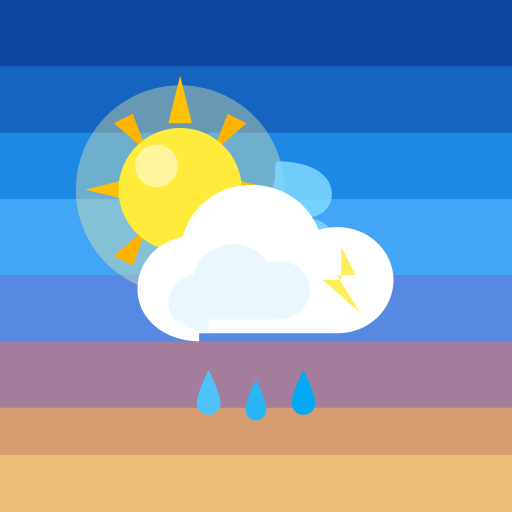
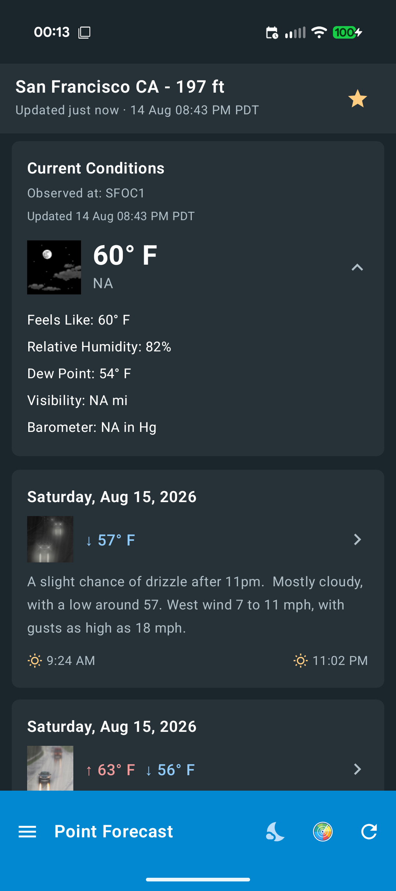
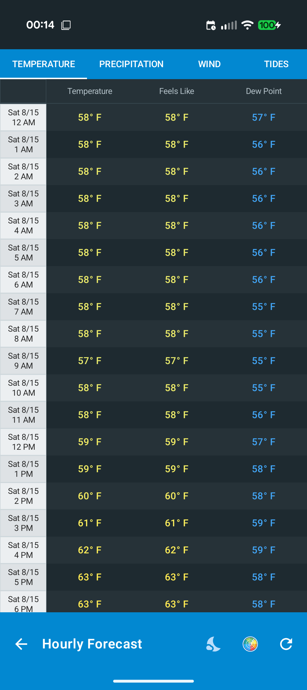
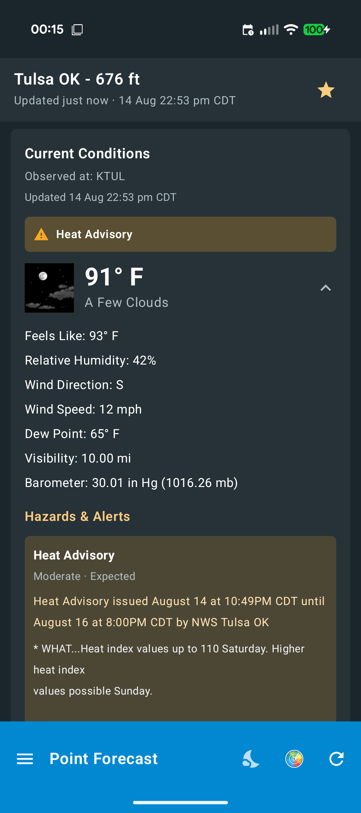
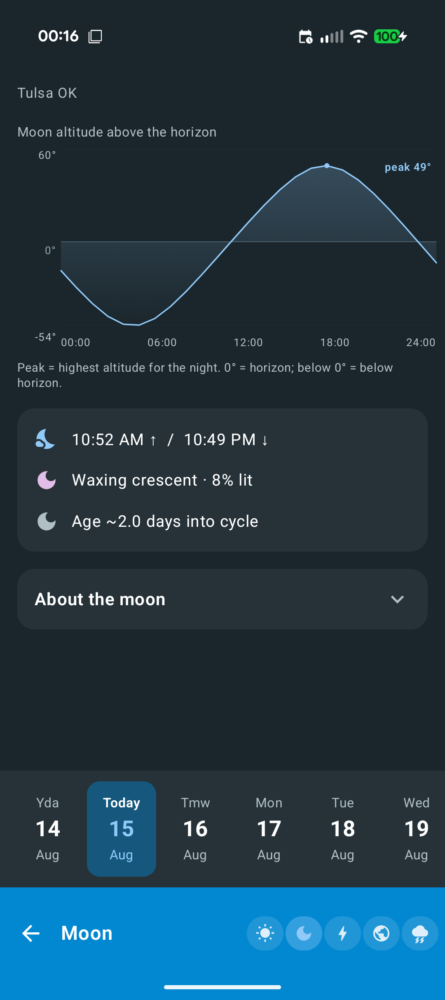

<p align="center">
  
</p>

<h1 align="center">Point Forecast</h1>

<p align="center">
  <strong>U.S. National Weather Service point forecasts</strong> on Android: clear, private, and fully open source.
</p>

<p align="center">
  <a href="https://f-droid.org/packages/com.crome.forecastpoint/"></a>
  <a href="https://github.com/crome1394/point-forecast/releases/latest"></a>
  
  
  <a href="LICENSE"></a>
  <a href="https://buymeacoffee.com/crome1394"></a>
</p>

<p align="center">
  <a href="https://f-droid.org/packages/com.crome.forecastpoint/"></a>
</p>

Point Forecast shows the NWS forecast for any U.S. point, along with hourly tables, alerts, radar, tides, and a hub for sun, moon, space weather, earthquakes, and severe weather. It has no accounts, analytics, or ads, and it does not need Google Play Services. *Not affiliated with NOAA or the NWS.*

<p align="center">
  
  
  
  
</p>

## Features

| | |
|---|---|
| **Forecast** | Current conditions and the multi-day NWS forecast, with pull-to-refresh |
| **Hourly** | Tabs you can reorder: temperature, precipitation, wind, tides, air quality, visibility, pressure, UV, and space weather |
| **Tides** | Diagram of the nearest NOAA station for each city, with coordinates and station code; all saved cities are one tap away |
| **Today's tides** | Two lows and two highs in a compact table under Current Conditions, hidden for landlocked cities |
| **Alerts** | Active watches, warnings, and advisories from NWS CAP |
| **Map and radar** | Pick a location on OpenStreetMap or search by city; open weather.gov radar from the app bar |
| **Hazard hub** | Sun and moon, space weather, earthquakes, tornadoes, and tropical cyclones, with maps and history windows |
| **Widget** | Home screen widget that uses bundled NWS icons |
| **Units** | US customary or metric, including the NWS forecast text |

## Install

| Channel | Notes |
|---|---|
| [F-Droid](https://f-droid.org/packages/com.crome.forecastpoint/) | Recommended. Reproducible builds signed by the developer |
| [GitHub Releases](https://github.com/crome1394/point-forecast/releases) | `app-release-signed.apk`, signed with the same key as the F-Droid build |

If you installed an F-Droid build older than 1.1.9, uninstall it once and reinstall.

## Build

Requires JDK 17+ and the Android SDK.

```bash
cd forecast-point
./gradlew :app:assembleDebug     # or :app:assembleRelease
```

## Documentation

| Document | What's in it |
|---|---|
| [ARCHITECTURE.md](ARCHITECTURE.md) | Code layout, data flow, and every data source with its fallback |
| [PRIVACY.md](PRIVACY.md) | What leaves the device and where it goes |
| [RELEASE.md](RELEASE.md) | Steps for cutting a signed release |
| [docs/REPRODUCIBLE_BUILDS.md](docs/REPRODUCIBLE_BUILDS.md) | Verifying that an APK matches the source |
| [docs/F-DROID-SUBMISSION.md](docs/F-DROID-SUBMISSION.md) | F-Droid inclusion notes and the [metadata recipe](metadata/com.crome.forecastpoint.yml) |
| [CHANGELOG.md](CHANGELOG.md) | Release history |
| [CONTRIBUTING.md](CONTRIBUTING.md) | How to send changes |
| [NOTICE](NOTICE) | Credits for third-party data and libraries |

## Support

If Point Forecast is useful to you, you can support future updates at [buymeacoffee.com/crome1394](https://buymeacoffee.com/crome1394).

## License

[MIT](LICENSE). Third-party data and libraries keep their own terms; see [NOTICE](NOTICE).
